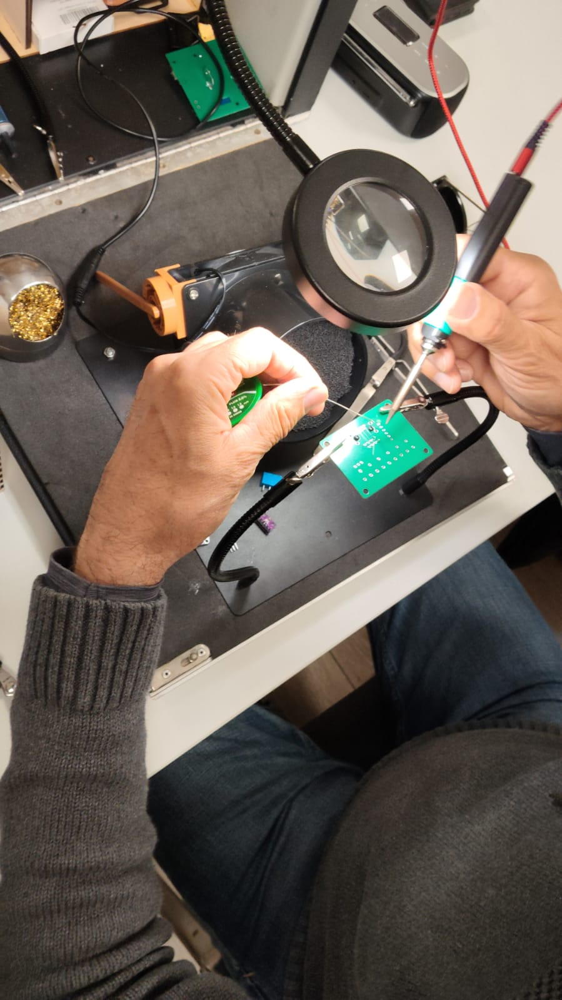
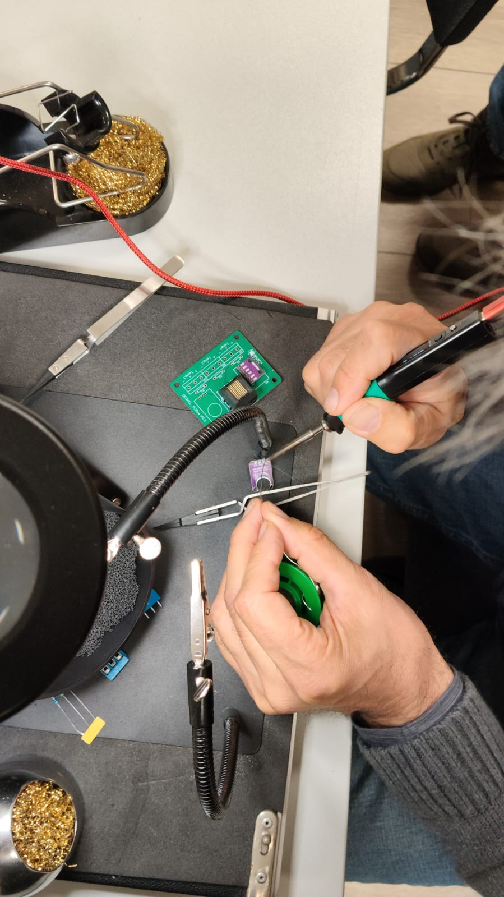
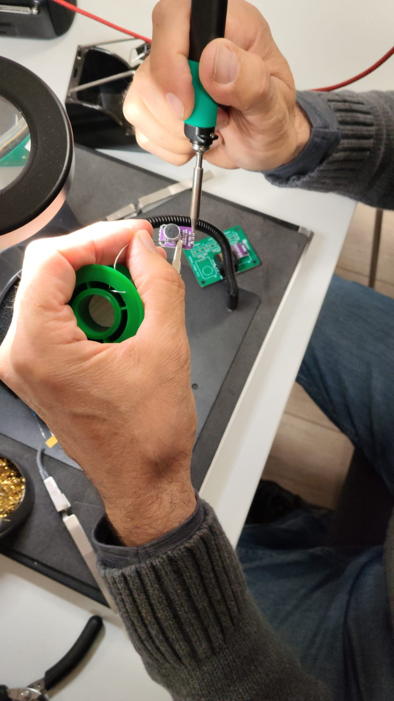
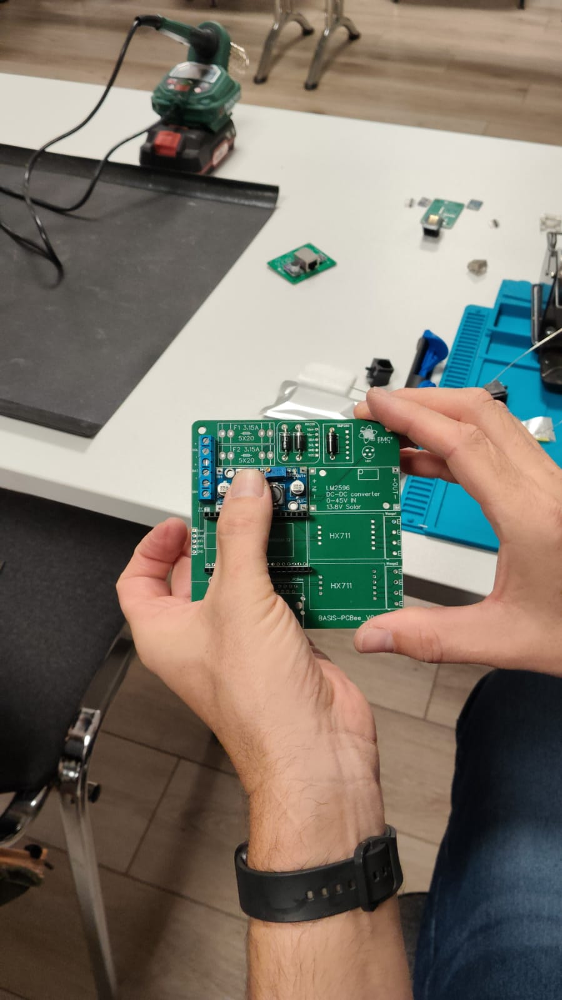

# Platinen-Fertigung (JLCPCB)

Die Platinen sind ein **eigenes Design** und können bei **[JLCPCB](https://jlcpcb.com/)**
(China) nachbestellt werden. Dieser Abschnitt beschreibt, wie man die Platinen bestellt
und bestückt.

## Design-Dateien

Zum Bestellen werden die Fertigungsdaten (Gerber-Dateien) benötigt. Für die Bestückung
sind zusätzlich Schaltplan und Stückliste hilfreich.

| Datei                      | Zweck                                      | Ablageort                                   |
| -------------------------- | ------------------------------------------ | ------------------------------------------- |
| Gerber-Dateien (`.zip`)    | Fertigung der Platine bei JLCPCB           | [`hardware/gerber/`](../hardware/gerber/)   |
| Schaltplan (Schematic)     | Verständnis der Verschaltung               | [`hardware/schaltplan/`](../hardware/schaltplan/) *(wird noch hochgeladen)* |
| Bestückungsplan            | Position der Bauteile                      | *(noch zu ergänzen)*                        |
| Stückliste (BOM)           | Liste aller Bauteile zum Einkauf           | [`hardware/bom/`](../hardware/bom/)         |

> Die Gerber- und BOM-Dateien werden je Platine (Deckel, Haupt, 3. Platine) in den
> Ordnern [`hardware/gerber/`](../hardware/gerber/) bzw. [`hardware/bom/`](../hardware/bom/)
> abgelegt. *(Dateien werden noch hinzugefügt.)*

## Bestellung bei JLCPCB (Ablauf)

1. Konto bei [JLCPCB](https://jlcpcb.com/) anlegen.
2. Gerber-Datei (`.zip`) der gewünschten Platine hochladen.
3. Fertigungsoptionen prüfen/wählen:
   - **Lagenanzahl:** *(noch zu ergänzen, i. d. R. 2 Lagen)*
   - **Platinendicke:** *(noch zu ergänzen, Standard 1,6 mm)*
   - **Lötstopplack-Farbe / Bestückungsdruck:** frei wählbar
   - **Oberfläche:** HASL (bleifrei) oder ENIG
4. Menge wählen (Mindestmenge beachten, oft 5 Stück).
5. Optional **Bestückung durch JLCPCB** (SMT Assembly) auswählen – dann werden
   BOM- und Pick-&-Place-Dateien benötigt. *(ob genutzt: noch zu ergänzen)*
6. Bestellung prüfen und absenden.

> 💡 **Tipp:** Es werden drei verschiedene Platinen benötigt (Deckel, Haupt, 3. Platine).
> Jede Platine wird mit ihren **eigenen** Gerber-Dateien separat bestellt.

## Bauteile / Bestückung

Die vollständige Stückliste liegt als Excel-Datei je Platine unter
[`hardware/bom/`](../hardware/bom/). Die wichtigsten Bauteile im Überblick:

- **ESP32** (Hauptplatine)
- **HX711** Wägeverstärker (Hauptplatine)
- **BME280** Umgebungssensor (Deckel-Platine)
- Sockel/Klemmen für bis zu **3× DS18B20** (Deckel-Platine)
- **Mikrofon** (Deckel-Platine)
- **LoRa-Modul** *(Typ noch zu ergänzen)*
- **RJ45-Buchsen** zur Verbindung der Platinen
- Bauteile der Stromversorgung (siehe [Stromversorgung](stromversorgung.md))

> **Noch zu ergänzen:** vollständige Stückliste je Platine inkl. Bauteilwerten und
> Bezugsquellen; Hinweise, welche Teile von Hand gelötet werden und welche per SMT.

## Beschriftung auf der Platine

> ✅ **Die Platine ist durchgängig beschriftet (Bestückungsdruck): Es ist eindeutig
> gekennzeichnet, welches Bauteil an welche Position gehört.**

Für jedes Bauteil ist auf der Platine aufgedruckt, wohin es gehört – inklusive der
Hinweise zur **Einbaurichtung** bei gepolten Bauteilen. Konkret bedeutet das z. B.:

- **Dioden:** Position und Typ sind aufgedruckt; der **weiße Ring** markiert die
  Minus-Seite (siehe unten).
- **Netzteile (LM2596S):** **IN/OUT** ist auf Modul und Platine beschriftet.
- **Schraubklemmen:** Solar / Batterie / Wartungsschalter sind gekennzeichnet.

Beim Bestücken daher **immer dem Aufdruck auf der Platine folgen** und im Zweifel mit
**Schaltplan** und **BOM** abgleichen.

## Lötzinn: bleifrei oder bleihaltig

Beim Löten von Hand gibt es zwei Arten von Lötzinn:

- **Bleihaltig** (z. B. Sn60Pb40): schmilzt niedriger und lässt sich **einfacher
  verarbeiten** – gut für Einsteiger. **Aber:** im **gewerblichen Bereich nicht mehr
  erlaubt** (RoHS).
- **Bleifrei** (z. B. SAC305): **RoHS-konform** und für den gewerblichen Einsatz
  vorgeschrieben. Etwas höhere Löttemperatur und etwas anspruchsvoller zu verarbeiten.

> **Empfehlung:** Für den privaten Nachbau kann bleihaltiges Lötzinn das Löten erleichtern.
> Wer die Waage **gewerblich** baut oder in Verkehr bringt, muss **bleifrei** löten.

## Bauteile mit und ohne Einbaurichtung

Manche Bauteile müssen in einer **bestimmten Richtung** eingebaut werden, andere nicht:

- **Dioden – Richtung und Typ beachten!** Eine Diode leitet den Strom **nur in eine
  Richtung**. Der **schwarze Ring** auf der Diode kennzeichnet die **Minus-Seite**
  (Kathode). Auf der Platine ist an dieser Stelle ein **weißer Ring** aufgedruckt. Beim
  Einbau muss der **schwarze Ring der Diode auf die Seite des weißen Rings** auf der
  Platine zeigen. Wird die Diode falsch herum eingebaut, funktioniert die Schaltung nicht
  (oder kann beschädigt werden).

  Außerdem gibt es **verschiedene Diodentypen**. Auf der Platine ist **aufgedruckt, welche
  Diode an welche Position** gehört. Deshalb **auf beides achten**: die **richtige Diode**
  an der richtigen Stelle **und** die korrekte **Polarität**. Im Zweifel die Bezeichnung
  auf der Platine mit der [BOM](#bauteile--bestückung) abgleichen.
- **LEDs – Richtung beachten!** Auch LEDs sind **gepolt**. Eine Seite der LED ist
  **abgeschrägt** (abgeflacht). Auf der Platine ist die Position **ebenfalls abgeschrägt**
  dargestellt. Beim Einbau muss die **abgeschrägte Seite der LED mit der abgeschrägten
  Markierung auf der Platine übereinstimmen** – also ähnlich wie bei der Diode. Falsch
  herum eingebaut leuchtet die LED nicht.
- **Widerstände – Richtung egal.** Widerstände haben **keine** Einbaurichtung und können
  in beliebiger Orientierung eingelötet werden.

> 💡 Weitere gepolte Bauteile (z. B. Elkos, ICs) ebenfalls auf die Markierung achten.
> *(konkrete Liste noch zu ergänzen)*

## Löten: worauf achten

- **Keine Lötbrücken:** Benachbarte **Pins dürfen beim Löten nicht miteinander verbunden**
  werden. Nach dem Löten alle Pins prüfen (Sichtkontrolle, ggf. Lupe/Durchgangsprüfer) und
  versehentliche Brücken entfernen. Lötbrücken (Kurzschlüsse) können die Elektronik
  beschädigen.
- ⚠️ **Lötdampf ist gesundheitsschädlich:** Die beim Löten entstehenden Dämpfe (Flussmittel)
  **nicht einatmen**. Für **gute Belüftung** sorgen und möglichst eine **Lötrauchabsaugung**
  bzw. einen Aktivkohle-Lüfter verwenden. Nach dem Löten Hände waschen.

### Löten in der Praxis

Löten der **Deckel-Platine** (hier mit Lötkolben und Lötzinn an der Lötstation):

Das **Mikrofon** auf der Deckel-Platine wird unter einer Lupenleuchte eingelötet:

Löten eines **Netzteil-Moduls** auf der Hauptplatine:

## Hinweise

- Lieferzeit aus China einplanen (Versand mehrere Tage bis Wochen).
- Evtl. anfallende **Zollgebühren/Einfuhrumsatzsteuer** beachten.
