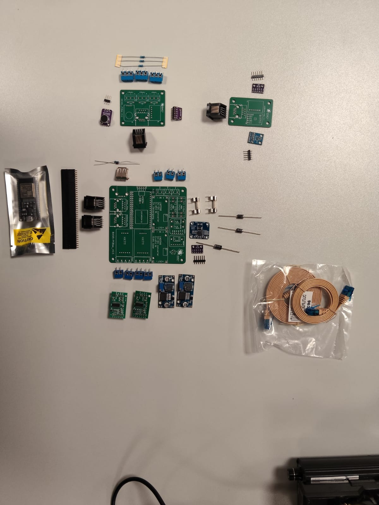
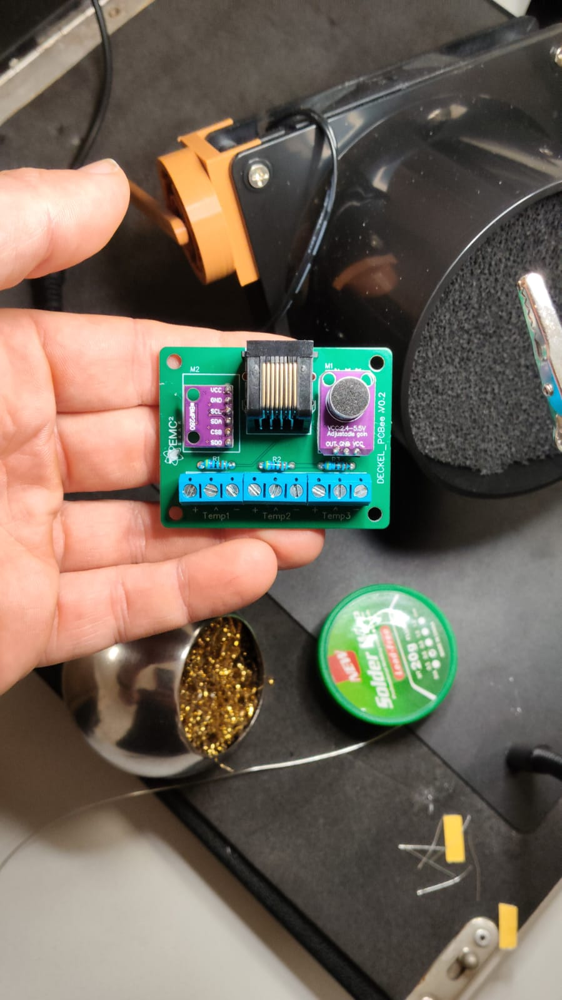
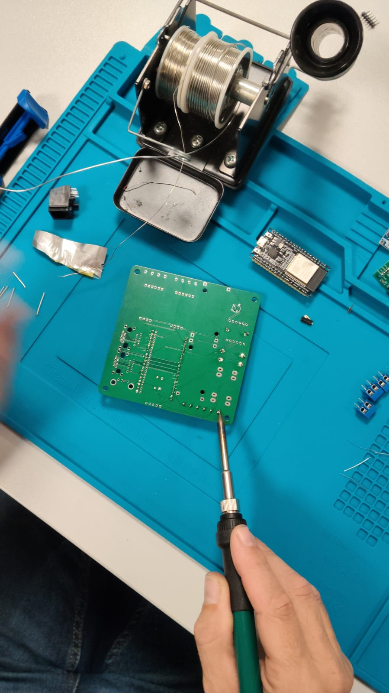
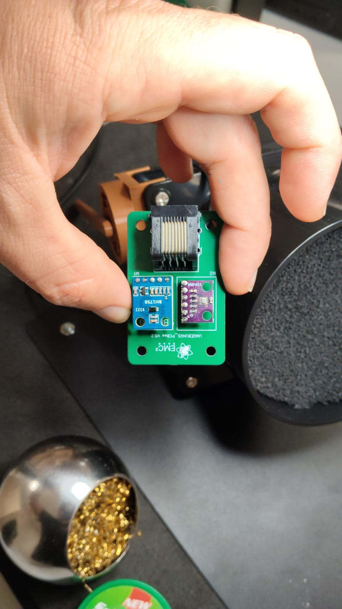

# Hardware & Platinen

Die Imker-Waage besteht aus mehreren eigenen Platinen (eigenes Design, nachbestellbar bei
JLCPCB – siehe [Fertigung](fertigung.md)). Herzstück ist ein **ESP32 DevKit V4**, der die
Sensoren ausliest und die Daten per WLAN überträgt.



## Übersicht der Platinen

| Platine                          | Einbauort        | Bestückung (Auszug)                                       |
| -------------------------------- | ---------------- | --------------------------------------------------------- |
| Deckel-Platine (`DECKEL_PCBee`)  | Gehäusedeckel    | Mikrofon, BME280, 3× DS18B20-Klemmen (Temp1–Temp3), RJ45  |
| Hauptplatine (`BASIS-PCBee`)     | Außengehäuse     | ESP32, 2× HX711, BMP280, INA219, Netzteile, Stromanschlüsse |
| Umgebungsplatine (`UMGEBUNGS_PCBee`) | *(Einbauort noch zu ergänzen)* | BH1750 (Helligkeit) und weiterer Sensor-Steckplatz, RJ45 |

Die Platinen sind untereinander über ein **RJ45-Kabel** verbunden (siehe unten).

## Deckel-Platine (`DECKEL_PCBee`)

Sitzt im Deckel des Gehäuses und trägt die Umwelt-Sensorik:

- **Mikrofon** (M1, MAX4466) – zur Erfassung von Stockgeräuschen; Modul mit einstellbarer
  Verstärkung (Aufdruck „VCC 2.4–5.5V, adjustable gain"). Die Firmware ermittelt daraus per
  **FFT** eine **Frequenz** (ADC `GPIO34`, siehe [Software](software.md))
- **BME280** (M2) – Temperatur, Luftfeuchte und Luftdruck (I²C)
- **Platz für bis zu 3× DS18B20** – Temperatursensoren (1-Wire); die Schraubklemmen sind mit
  **Temp1**, **Temp2** und **Temp3** beschriftet (z. B. innen/außen/Stock)
- **RJ45-Buchse** – Verbindung zur Hauptplatine



## Hauptplatine (`BASIS-PCBee`, Außengehäuse)

Die zentrale Platine im Außengehäuse enthält:

- **ESP32 DevKit V4** – Mikrocontroller, Steuerung und Funk (WLAN); die Platine unterstützt
  **zwei ESP32-Varianten** (siehe unten)
- **2× HX711** – 24-Bit-Wägeverstärker (ADC) für die Gewichtsmessung (je ein HX711 pro
  Wägekanal, auf der Platine mit **HX711** beschriftet)
- **2× Wägesensoren** – angeschlossen über die HX711 *(Typ/Belastbarkeit noch zu ergänzen)*
- **Stromversorgung** – Anschluss für Akku/Netzteil und Solarmodul
  (Details siehe [Stromversorgung](stromversorgung.md))
- **Drei Schraubklemmen** – für **Solar**, **Batterie** und **Wartungsschalter**
  (siehe unten)
- **USB-A-Buchse** – reiner **5-V-Ausgang** (keine Datenverbindung, siehe unten)
- **BMP280** – Temperatur- und Luftdrucksensor auf der **Rückseite** der Hauptplatine
  (siehe unten)
- **INA219** – misst **Spannung und Strom** von **Batterie** und **Solarzelle**
  (siehe unten)

### ESP32-Varianten (zwei Footprints)

Die Hauptplatine ist so gestaltet, dass **zwei unterschiedliche ESP32-Module** bestückt
werden können. Die Module unterscheiden sich in der **Breite des Footprints**:

- **Breiterer Footprint** – für das breitere ESP32-Modul
- **Schmalerer Footprint** – für das schmalere ESP32-Modul

Beim Bestücken wird **nur eine** der beiden Varianten eingesetzt – passend zu dem
ESP32-Modul, das euch vorliegt. Die jeweils andere Footprint-Position bleibt frei.

> **Noch zu ergänzen:** genaue Modulbezeichnungen (z. B. ESP32-WROOM-32 vs. eine schmalere
> Variante), damit klar ist, welches Modul in welchen Footprint gehört.

### Wägesensoren und HX711

- Die beiden Wägesensoren werden an den **HX711** angeschlossen, der das Signal
  verstärkt und digitalisiert und per Datenleitung an den ESP32 übergibt.
- Die Anschluss-Schraubklemmen sind mit **Waage1** und **Waage2** beschriftet und liegen
  **in der Nähe des HX711** auf der Platine.
- **Kalibrierung** ist nach dem Aufbau erforderlich (siehe [Software](software.md)).

> ✅ **Welche Wägezelle?** Grundsätzlich funktionieren **alle gängigen Wägezellen** mit der
> Platine – sie stellen die gleichen Anforderungen und sind austauschbar. Entscheidend ist,
> dass die Waage nach dem Einbau **kalibriert** wird (siehe
> [Software → Kalibrierung](software.md#kalibrierung-der-waage)).

> **Belastbarkeit:** Es funktionieren mehr oder weniger **alle Wägezellen** – ein konkretes
> Modell (Plattformwaage) ist in der [BOM](../hardware/bom/BOM-Bienenbeute.xlsx) verlinkt.
> Die nötige Belastbarkeit hängt vom
> **erwarteten Gewicht** ab und davon, ob **eine oder zwei** Wägezellen verbaut werden. Die
> günstigen **Paketwaagen von eBay** haben eine Wägezelle, die mit **mindestens 150 kg**
> belastbar sein sollte.
>
> **Pinbelegung:** Die Belegung ist leider **unterschiedlich** und muss durch
> **Ausprobieren** ermittelt werden (die Rohwerte müssen bei Belastung steigen).

### Netzteile / Spannungsversorgung auf der Platine

Auf der Hauptplatine sitzen **zwei Netzteil-Module** vom Typ **DC-DC LM2596S**
(einstellbare Step-Down-/Abwärtswandler):

| Modul                       | Aufgabe                                                        |
| --------------------------- | ------------------------------------------------------------- |
| Laderegler (rechtes Netzteil) | lädt den Akku aus dem Solarmodul – **nur bei Solarbetrieb nötig** |
| Versorgung                  | versorgt den Rest der Platine (ESP32, Sensoren usw.)          |

> 🛑 **Spannung VOR dem Einbau des Controllers einstellen!** Die LM2596S-Module sind
> einstellbar. Die Ausgangsspannungen müssen am Poti **eingestellt und gemessen** werden,
> **bevor** der ESP32 (Controller) eingesetzt wird: **Batteriespannung 14,3 V** und
> **5-V-Versorgung genau 5,0 V**. Wird der Controller bei falsch eingestellter (zu hoher)
> Spannung eingebaut, kann er **zerstört** werden. Ausführliche Vorgehensweise siehe
> [Stromversorgung → Erstes Bestromen und Spannungen einstellen](stromversorgung.md#erstes-bestromen-und-spannungen-einstellen).

#### 5-V-Brücke (Lötjumper)

Auf dem Board gibt es einen **Lötjumper „5V-Brücke"**. Erst wenn diese **Brücke geschlossen**
ist, wird der **Rest des Boards mit 5 V versorgt**. Das erlaubt, die Netzteil-Spannungen
zunächst einzustellen, ohne gleich das ganze Board (und den ESP32) zu versorgen. Die Brücke
wird **erst geschlossen, nachdem die Spannungen korrekt eingestellt** wurden (siehe
[Stromversorgung → Erstes Bestromen und Spannungen einstellen](stromversorgung.md#erstes-bestromen-und-spannungen-einstellen)).

Die Netzteil-Module werden über **Stiftleisten** mit der Platine verbunden. Die
Stiftleisten dienen dazu, die Module **einfacher anzulöten** (statt die Module direkt
flach auf die Platine zu löten).

> ⚠️ **Einbaurichtung beachten!** Auf den Netzteil-Modulen stehen **IN** und **OUT**, und
> auf der Platine ebenfalls. Beim Einbau müssen **IN/OUT des Moduls mit IN/OUT auf der
> Platine übereinstimmen**. Falsch herum eingebaut funktioniert die Versorgung nicht bzw.
> kann Schaden entstehen.

> **Noch zu ergänzen:** genaue Modultypen der beiden Netzteile und Ausgangsspannungen.

### Schraubklemmen (Anschlüsse)

Auf der Hauptplatine befinden sich **drei Schraubklemmen** (je mit **+/−**), auf der Platine
beschriftet mit:

| Aufdruck | Klemme            | Anschluss für                                       |
| -------- | ----------------- | --------------------------------------------------- |
| **SOL**  | Solar             | Solarmodul (bis 30 W / max. 40 V)                   |
| **BAT**  | Batterie          | Akku / Batterie (bzw. Netzteil, 6–40 V)             |
| **SRV**  | Wartungsschalter  | externer Schalter zum stromlos Schalten bei Wartung |

Details zur Stromversorgung siehe [Stromversorgung](stromversorgung.md).

### BMP280 (Rückseite der Hauptplatine)

Auf der **Rückseite** der Hauptplatine wird ein **BMP280** bestückt – ein Sensor für
**Temperatur und Luftdruck**.

> ℹ️ **Nicht mit dem BME280 der Deckel-Platine verwechseln:** Der **BMP280** misst nur
> **Temperatur und Luftdruck** (keine Luftfeuchte), der **BME280** auf der Deckel-Platine
> misst zusätzlich die **Luftfeuchte**. Es sind also zwei unterschiedliche Sensoren an
> zwei Orten.

> **Wichtig beim Bestücken:** Der BMP280 kommt auf die **andere Seite** (Rückseite) der
> Hauptplatine.



### INA219 (Strom- und Spannungsmessung)

Auf der Hauptplatine sitzt ein **INA219**. Er misst **Spannung und Strom** – konkret für
die **Batterie** und die **Solarzelle**. Damit lässt sich überwachen:

- die **Batteriespannung** (Ladezustand),
- die **Solarspannung**,
- der **Strom**, der fließt (Laden aus Solar bzw. Entnahme).

So ist jederzeit nachvollziehbar, wie viel das Solarmodul liefert und wie es um die
Energieversorgung der Waage steht. Details zur Energieversorgung siehe
[Stromversorgung](stromversorgung.md).

> **Noch zu ergänzen:** ob ein oder mehrere INA219 verbaut sind bzw. wie Batterie- und
> Solarmessung genau aufgeteilt sind (I²C-Adresse/Shunt).

### Sicherungen

Auf der Platine sitzen **zwei Sicherungen** (Feinsicherungen, Bauform **5×20 mm**), die den
**Strom begrenzen**. Sie schützen die Elektronik: Fällt z. B. ein Netzteil aus bzw. tritt
ein Defekt auf, verhindert die Sicherung einen **größeren Folgeschaden**. Auf der Platine
sind sie mit **F1** und **F2** (je **3,15 A**) beschriftet.

### USB-A-Buchse (5-V-Ausgang)

Auf der Hauptplatine wird eine **USB-A-Buchse** angelötet. Sie dient **ausschließlich dazu,
die 5 V der Platine nach außen zu führen** (z. B. zur Versorgung eines kleinen
Zusatzgeräts).

So lässt sich darüber z. B. ein **LTE-Hotspot** mit Strom versorgen – praktisch an
Standorten **ohne WLAN**, um die Waage trotzdem ins Internet zu bringen.

> ℹ️ Die Buchse hat **keine Datenfunktion** – es werden nur die **5 V** herausgeführt, es
> findet **keine USB-Datenkommunikation** statt. Zum **Flashen** des ESP32 wird daher
> **nicht** diese Buchse genutzt, sondern die **USB-Buchse am ESP32-DevKit** (siehe
> [Software → Erstes Flashen](software.md#erstes-flashen-esp-web-flasher)).

> **Noch zu ergänzen:** maximal entnehmbarer Strom an der USB-Buchse.

## Umgebungsplatine (`UMGEBUNGS_PCBee`)

Dies ist die „3. Platine". Sie trägt:

- **BH1750** – Sensor für die **Helligkeit** (Lichtstärke, I²C)
- einen weiteren **Sensor-Steckplatz** *(Bestückung/Zweck noch zu ergänzen)*
- **RJ45-Buchse** – Verbindung zu den übrigen Platinen



> **Noch zu ergänzen:** Einbauort der Umgebungsplatine und welcher Sensor auf dem zweiten
> Steckplatz sitzt.

## Verbindung der Platinen (RJ45)

Die Platinen sind über ein **RJ45-Kabel** (Standard-Netzwerkkabel) miteinander verbunden.
Darüber laufen Stromversorgung und die Sensor-/Bussignale zwischen den Platinen.

> **Wichtig:** Auch wenn ein RJ45-Stecker verwendet wird, handelt es sich **nicht um Ethernet**.
> Das Kabel wird hier nur als praktische, robuste Steckverbindung genutzt.

> **Noch zu ergänzen:** Pinbelegung des RJ45-Steckers (welches Signal auf welchem Pin),
> maximale Kabellänge.

## Blockschaltbild

```
         [ Deckel-Platine (DECKEL_PCBee) ]
   Mikrofon · BME280 · 3× DS18B20 (Temp1–Temp3)
                     |
                   RJ45
                     |
         [ Hauptplatine (BASIS-PCBee) ]
   ESP32 · 2× HX711 (Waage1/Waage2) · BMP280 · INA219
         |                              |
   Stromversorgung                  Funk: WLAN
 (SOL / BAT / SRV)                 (WLAN → ThingSpeak)
                     |
                   RJ45
                     |
       [ Umgebungsplatine (UMGEBUNGS_PCBee) ]
         BH1750 (Helligkeit) · (weiterer Sensor)
```

*(Verschaltung schematisch – finale Verdrahtung/Pinbelegung noch zu ergänzen.)*
