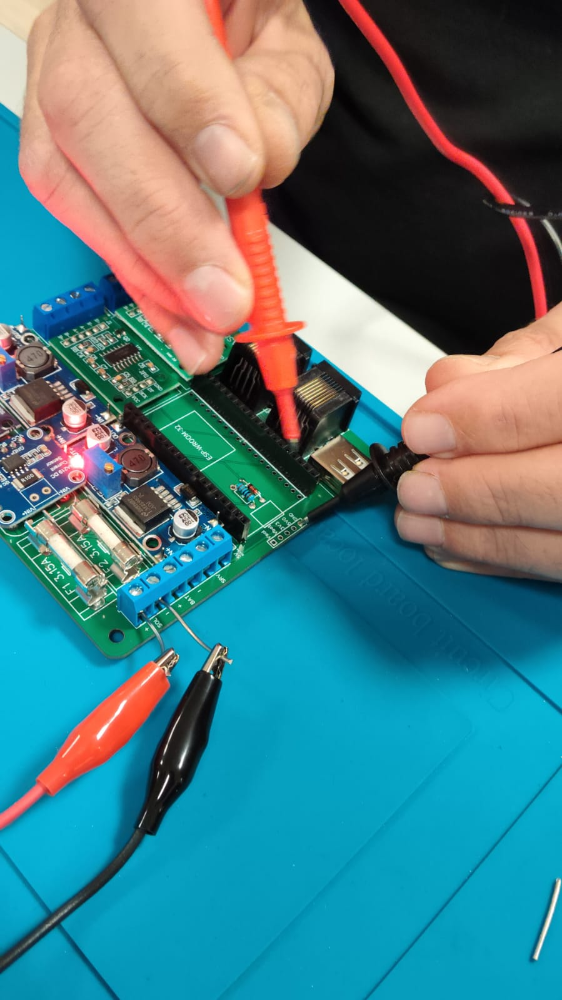
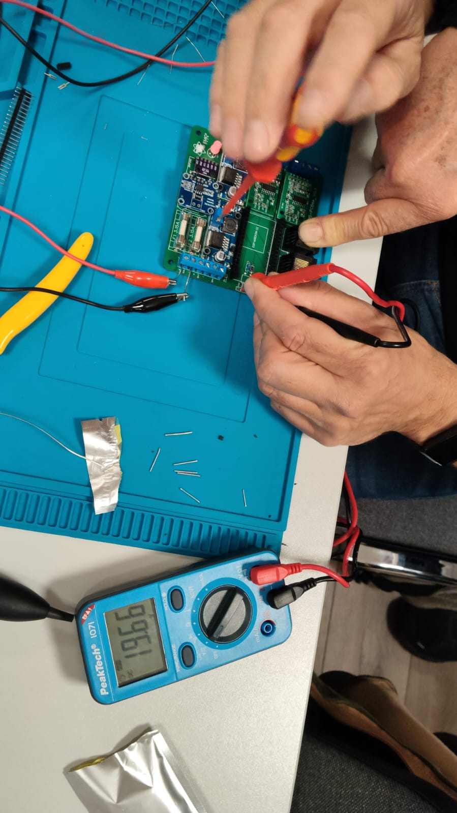
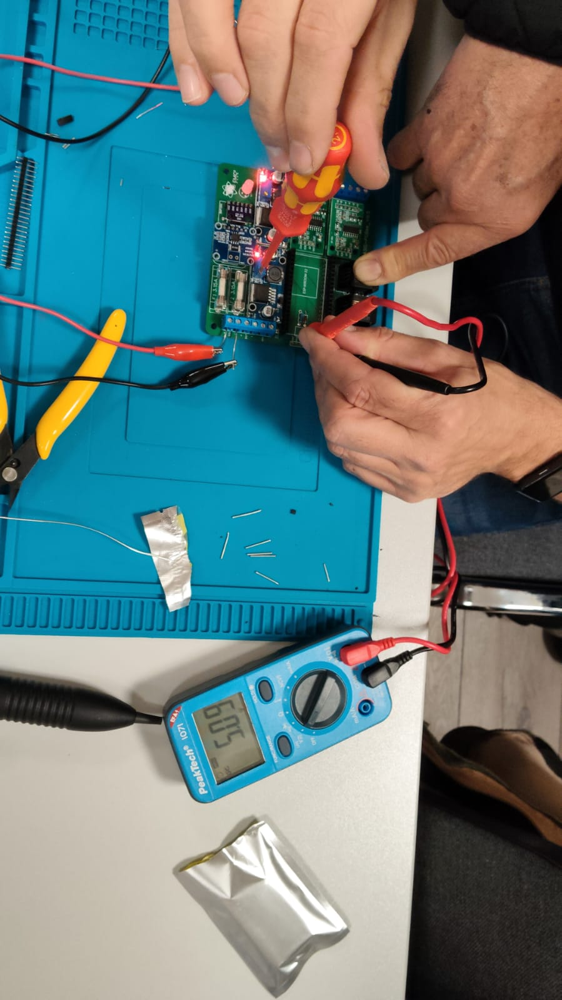
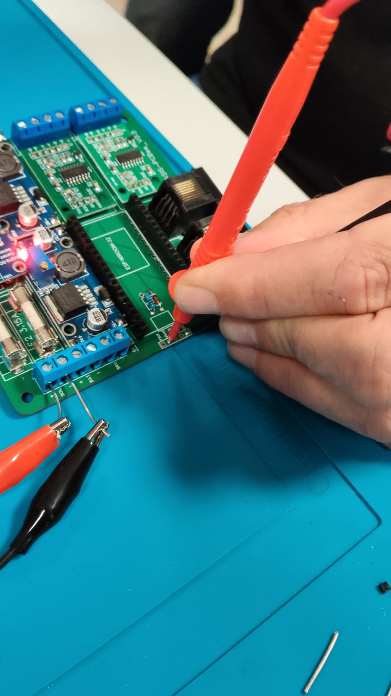
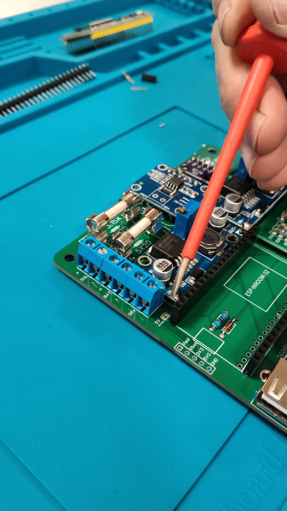

# Stromversorgung

Die Imker-Waage ist für den **Dauerbetrieb im Außenbereich** ausgelegt und kann flexibel
mit Akku, Netzteil und/oder Solarmodul versorgt werden. Alle Anschlüsse befinden sich auf
der **Hauptplatine** im Außengehäuse.

## Versorgungsvarianten

| Quelle                | Spannung / Leistung           | Hinweis                              |
| --------------------- | ----------------------------- | ------------------------------------ |
| Externer Akku         | 6–40 V                        | z. B. Blei-/LiFePO4-Akku *(Typ noch zu ergänzen)* |
| Netzteil              | 6–40 V                        | fester Netzanschluss, wenn vorhanden |
| Solarmodul            | bis **30 W**, max. **40 V**   | für autarken Betrieb                 |

> **Wichtig:** Die Eingangsspannung muss im Bereich **6–40 V** liegen. Das Solarmodul darf
> **40 V nicht überschreiten** und **maximal 30 W** liefern.

## Typische Aufbauten

- **Netzbetrieb:** Netzteil 6–40 V direkt anschließen (wenn Stromanschluss am Stand vorhanden).
- **Autark mit Solar:** Solarmodul (bis 30 W / 40 V) plus Pufferakku für Nacht und
  schlechtes Wetter.
- **Reiner Akkubetrieb:** nur Akku, regelmäßig laden/tauschen.

> **Noch zu ergänzen:** empfohlene Akku-Kapazität (Ah) und Solarpanel-Größe je nach
> Standort/Region; Laderegler-/Ladeelektronik auf der Platine (vorhanden? MPPT?);
> typische Stromaufnahme der Waage im Betrieb und im Schlafmodus.

## Netzteile auf der Platine

Die Hauptplatine hat **zwei Netzteil-Module** vom Typ **DC-DC LM2596S** (einstellbare
Abwärtswandler):

- **Laderegler (rechtes Netzteil)** – lädt den Akku aus dem Solarmodul.
  **Nur bei Solarbetrieb nötig** (Batteriespannung 14,3 V).
- **Versorgung** – erzeugt die Spannung für den Rest der Platine (ESP32, Sensoren usw.).

Beide Module werden über **Stiftleisten** mit der Platine verbunden; das erleichtert das
Anlöten. Die einzustellenden Soll-Ausgangsspannungen sind:

- **Batteriespannung (Laderegler):** **14,3 V**
- **5-V-Versorgung:** genau **5,0 V**

> 🛑 **Wichtig – Spannungen VOR dem Controller-Einbau einstellen!** Die LM2596S-Module sind
> über ein Poti einstellbar. Die **Ausgangsspannungen unbedingt einstellen und nachmessen,
> bevor der ESP32 (Controller) eingebaut wird.** Eine zu hohe Spannung kann den Controller
> zerstören. Die genaue Vorgehensweise steht unten unter
> [Erstes Bestromen und Spannungen einstellen](#erstes-bestromen-und-spannungen-einstellen).

> ⚠️ **Einbaurichtung beachten!** Auf den Netzteil-Modulen und auf der Platine sind **IN**
> und **OUT** beschriftet. Beim Einbau müssen **IN/OUT des Moduls mit IN/OUT auf der
> Platine übereinstimmen**.

## Erstes Bestromen und Spannungen einstellen

Bevor der ESP32 eingesetzt wird, wird die Platine **das erste Mal bestromt** und die beiden
Netzteil-Spannungen werden eingestellt und gemessen.

> 🛑 **Das erste Bestromen erfolgt ausdrücklich OHNE den ESP32!** Der Controller wird erst
> eingesetzt, wenn beide Spannungen korrekt eingestellt sind (14,3 V und genau 5,0 V).

> ℹ️ **Zweites Netzteil (rechts) nur bei Solarbetrieb nötig.** Das **rechte (zweite)
> Netzteil** – der **Laderegler für die Batteriespannung (14,3 V)** – wird **nur benötigt,
> wenn eine Solarzelle angeschlossen** werden soll. Wer die Waage ohne Solar betreibt (nur
> Akku/Netzteil), braucht diese Einstellung nicht.

### 1. Spannung anlegen

- Spannung an **Solar +/−** (Klemme **SOL**) anlegen.
- **Zum Einstellen der Spannungen** eine Quelle mit **16–40 V** verwenden (z. B. ein
  **Werkzeugakku** oder eine **Solarzelle**). **Ohne den Solarladeregler** (reiner
  Akku-/Netzbetrieb) reichen auch **6–40 V**.
- **Polung (+ / −) beachten.**

> ℹ️ **Warum 16–40 V und nicht 6–40 V?** Im normalen Betrieb akzeptiert die Waage
> **6–40 V** (siehe [Versorgungsvarianten](#versorgungsvarianten)). Die höhere
> Mindestspannung (**ab 16 V**) wird **nur** dann benötigt, wenn der **Solarladeregler**
> bestückt ist – damit er die **14,3 V** sicher ausregeln kann. **Ohne Solarladeregler
> reichen auch hier 6–40 V.**

### 2. Messpunkt (Messheader unter dem ESP32)

Unterhalb der ESP32-Position befindet sich ein **Messheader**. Dort ist aufgedruckt,
**welche Spannungen anliegen sollen**. Die Messpunkte sind beschriftet mit:

| Aufdruck | Bedeutung                              |
| -------- | -------------------------------------- |
| **Vsol** | Solarspannung                          |
| **Vbat** | Batteriespannung (Soll **14,3 V**)     |
| **3V3**  | 3,3 V (erst nach ESP32-Einbau, s. u.)  |
| **5V0**  | 5-V-Versorgung (Soll genau **5,0 V**)  |
| **GND**  | Masse / Minus                          |

- **GND = Minus** (schwarze Messleitung des Multimeters).
- Die rote Messleitung an den jeweiligen Messpunkt (**Vbat** bzw. **5V0**) halten.

### 3. Batteriespannung einstellen (14,3 V) – nur bei Solar

Die **Batteriespannung** wird am **zweiten Netzteil auf der rechten Seite** eingestellt
(**nur nötig, wenn eine Solarzelle angeschlossen wird**):

1. Am **Potentiometer (Poti)** des Netzteils drehen.
2. **Rechtsrum = höhere** Spannung, **linksrum = niedrigere** Spannung.
3. Es sind **mehrere Umdrehungen** nötig.
4. So lange drehen, bis das Multimeter am Messpunkt **Vbat** **14,3 V** anzeigt.

### 4. 5-V-Spannung einstellen (genau 5,0 V)

Anschließend die **5-V-Versorgung** einstellen:

1. Am Poti des zugehörigen Netzteils drehen.
2. So einstellen, dass das Multimeter am Messpunkt **5V0** **genau 5,0 V** anzeigt.

### 5. 5-V-Brücke (Lötjumper) schließen

Auf dem Board gibt es einen **Lötjumper „5V-Brücke"**. Erst wenn diese **Brücke geschlossen**
ist, wird der **Rest des Boards mit 5 V versorgt**.

- **Erst nachdem die Spannungen korrekt eingestellt** (14,3 V bei Solar und genau 5,0 V)
  **und gemessen** sind, wird die **Lötbrücke geschlossen**.
- Dadurch wird sichergestellt, dass das Board (und später der ESP32) **nie mit falscher
  Spannung** versorgt wird.

> ✅ Erst wenn die Spannungen stimmen **und** die 5-V-Brücke geschlossen ist, darf der
> **ESP32 eingesetzt** werden.

### 6. ESP32 aufstecken und 3,3 V prüfen

Jetzt kann der **ESP32-Controller aufgesteckt** werden. Danach sollte am Messpunkt zusätzlich
**3,3 V** messbar sein.

- Der ESP32 erzeugt aus den 5 V intern seine **3,3-V-Betriebsspannung**.
- Werden am Messheader **3,3 V** angezeigt, ist das ein gutes Zeichen, dass der Controller
  korrekt versorgt wird und arbeitet.
- Fehlen die 3,3 V, den Sitz des ESP32 und die vorherigen Spannungen (5 V) erneut prüfen.
- Gemessen wird am Messpunkt **3V3** (GND = Minus).

## Anschluss

Die Versorgung wird an den **Schraubklemmen** der **Hauptplatine** angeschlossen. Dafür
gibt es **drei Schraubklemmen** (je mit **+/−**), auf der Platine beschriftet mit:

| Aufdruck | Klemme            | Anschluss für                                       |
| -------- | ----------------- | --------------------------------------------------- |
| **SOL**  | Solar             | Solarmodul (bis 30 W / max. 40 V)                   |
| **BAT**  | Batterie          | Akku / Batterie (bzw. Netzteil, 6–40 V)             |
| **SRV**  | Wartungsschalter  | externer Schalter zum stromlos Schalten bei Wartung |

- **Polung beachten!** Verpolung kann die Elektronik zerstören.
- Der **Wartungsschalter** (SRV) dient dazu, die Waage für Wartungsarbeiten stromlos zu
  schalten. *(genaue Verdrahtung noch zu ergänzen)*

> ⚠️ **Sicherheit:** Auf korrekte Polung und zulässigen Spannungsbereich achten. Bei
> Solar- und Akkubetrieb geeignete Leitungsquerschnitte und ggf. Sicherung vorsehen
> *(Details noch zu ergänzen)*.

## Überwachung (INA219)

Zur Überwachung der Energieversorgung ist ein **INA219** auf der Platine verbaut. Er misst
**Spannung und Strom** von **Batterie** und **Solarzelle**:

- **Batteriespannung** – zeigt den Ladezustand des Akkus.
- **Solarspannung** – zeigt, ob/wieviel das Solarmodul liefert.
- **Strom** – wie viel Strom gerade fließt (Laden bzw. Verbrauch).

Diese Werte werden von der Software erfasst und können ausgewertet werden (siehe
[Software](software.md)).

## Sicherungen auf der Platine

Die Platine hat **zwei Feinsicherungen** (**F1** und **F2**, je **3,15 A**, Bauform
**5×20 mm**), die den **Strom begrenzen**. Dadurch wird im Fehlerfall – etwa bei einem
**defekten Netzteil** – ein **größerer Schaden verhindert**.

> **Noch zu ergänzen:** welcher Zweig von F1 bzw. F2 jeweils abgesichert ist.
